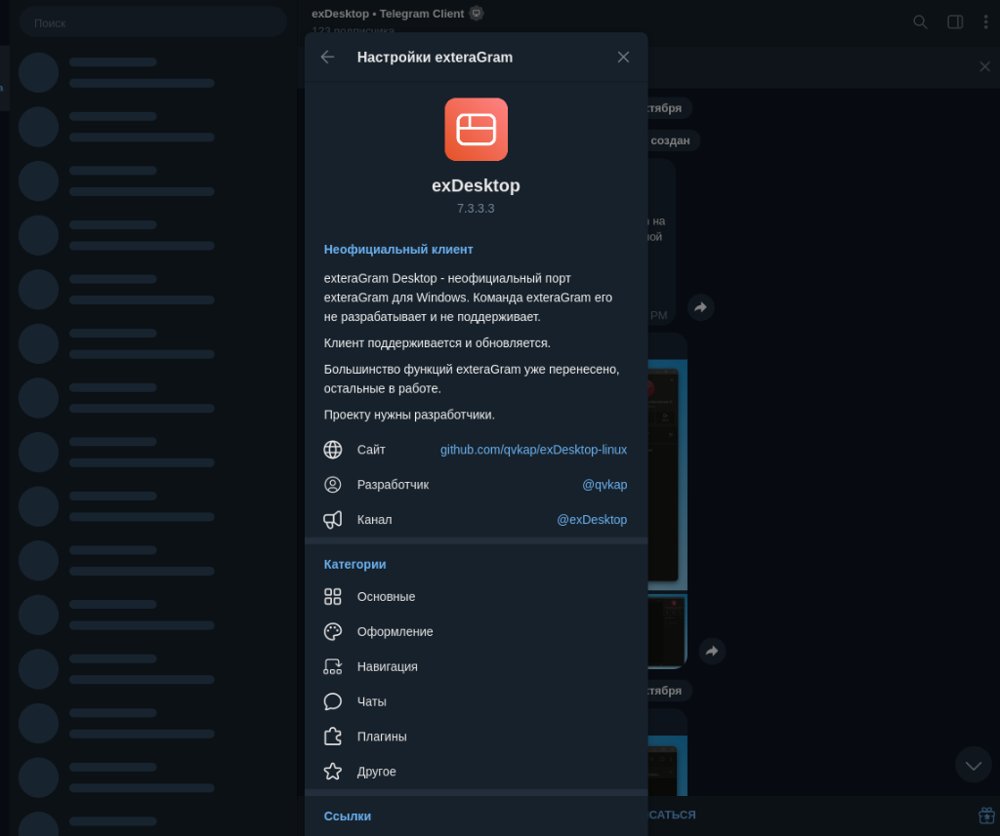
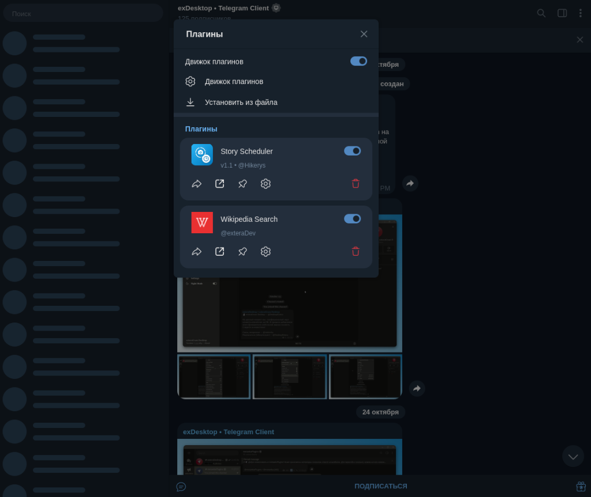

[](https://github.com/qvkap/exDesktop-linux/stargazers)


## exDesktop
*[Licensed under the GNU General Public License v3.0](LICENSE)*

An unofficial Linux & Windows client built from the official [Telegram Desktop](https://github.com/telegramdesktop/tdesktop) sources. It adds a customizable settings suite, channel feed, streamer tools and a native Python plugin engine.

[](https://t.me/exDesktop)
[](https://github.com/qvkap/exDesktop-linux)
[](https://t.me/qvkap)



## Features
- Settings for General, Appearance, Chats, Navigation, Plugins and Other.
- Native Linux support with full Wayland and X11 integration.
- Material Design 3 controls, adjustable avatar corners and custom themes.
- Channel feed, wide posts, precise timestamps, edit marks and forward counts.
- Streamer mode with per chat settings, exceptions and screen capture protection.
- Python plugin engine powered by system Python 3 C API (with per plugin settings and automatic safe mode).
- Gemini chat with your own API key.
- User IDs, data center and estimated registration date in profiles.



## Downloads
Get the Linux binary, packages or Windows builds from the [releases page](https://github.com/qvkap/exDesktop-linux/releases). On Linux, the Python plugin runtime is installed into `/usr/share/exDesktop/python/extera/` or detected locally.

## API credentials
Get your own API ID and hash from [Telegram's API credentials page](https://core.telegram.org/api/obtaining_api_id). Pass them to CMake or the configure script when generating project files:

```bash
-DTDESKTOP_API_ID=27795979 -DTDESKTOP_API_HASH=0b9b427e162605ce85210ab918a9c2d8
```

## Build on Linux

### Dependencies
- **CMake** >= 3.16 & C++20 compiler (GCC >= 12 or Clang >= 15)
- **Qt6** (Core, Gui, Widgets, Network, OpenGL, DBus, Wayland, Svg, ImageFormats)
- **Python 3** Development headers (`python3-dev` / `dev-lang/python`) 3.11 – 3.14
- Standard Telegram Desktop libraries: `tg_owt`, `ffmpeg`, `openal`, `opus`, `rnnoise`, `libjpeg-turbo`, `xxhash`, `minizip`, `ada`, `cld3`, `wallet-engine-telegram`

### Building via CMake
```bash
cmake -B build -G Ninja \
    -DCMAKE_BUILD_TYPE=Release \
    -DQT_VERSION_MAJOR=6 \
    -DDESKTOP_APP_DISABLE_QT_PLUGINS=ON \
    -DTDESKTOP_API_ID="27795979" \
    -DTDESKTOP_API_HASH="0b9b427e162605ce85210ab918a9c2d8"

cmake --build build --target Telegram
```

### Building on Gentoo / Portage
An ebuild `net-im/exdesktop` is available:
```bash
emerge net-im/exdesktop
```

### Python Plugin Runtime Setup
Copy the Python host runtime files to `/usr/share/exDesktop/python/extera/`:
```bash
sudo mkdir -p /usr/share/exDesktop/python/extera
sudo cp -r Telegram/SourceFiles/extera/python/* /usr/share/exDesktop/python/extera/
```

## Build on Windows
1. Follow the [Telegram Desktop Windows build guide](https://github.com/telegramdesktop/tdesktop/blob/dev/docs/building-win.md).
2. Put the embedded Python 3.11 runtime in `Libraries/win64/python311`. Include the headers, `python311.lib` and the `embed` folder.
3. Generate the project files with your API ID and hash using the configure script:
```cmd
python configure.py x64 -D TDESKTOP_API_ID=... -D TDESKTOP_API_HASH=...
```
4. Build the `Telegram` target:
```cmd
cmake --build out --config Release --target Telegram
```

The `python` folder next to `Telegram.exe` is required for plugins on Windows.

## Localization
Most strings follow Telegram Desktop translations. exDesktop specific strings are available in English and Russian.

## Thanks
- [Telegram Desktop](https://github.com/telegramdesktop/tdesktop)
- [AyuGram Desktop](https://github.com/AyuGram/AyuGramDesktop)

